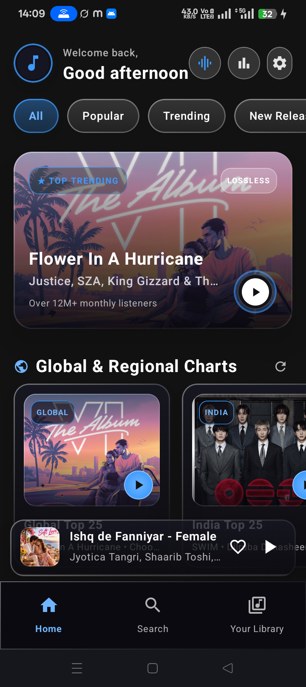
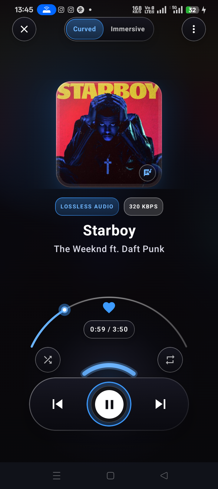
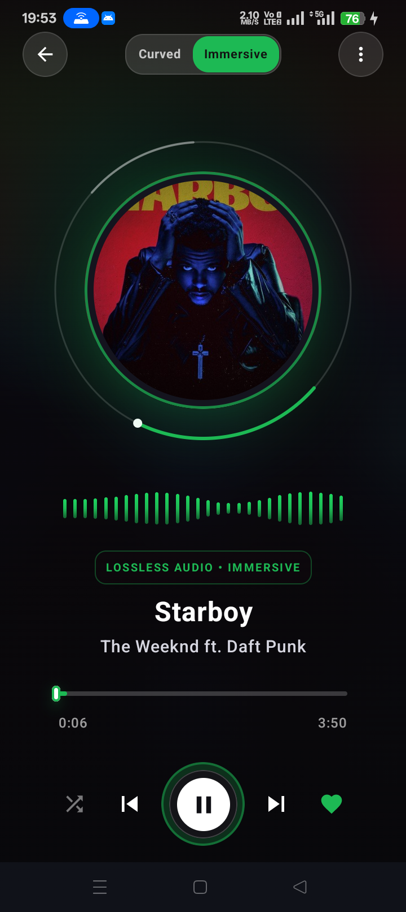
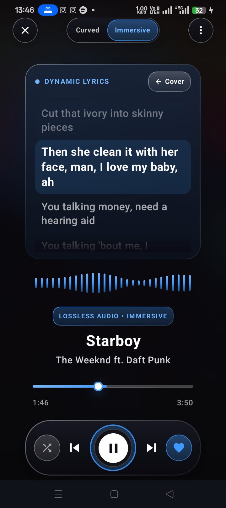
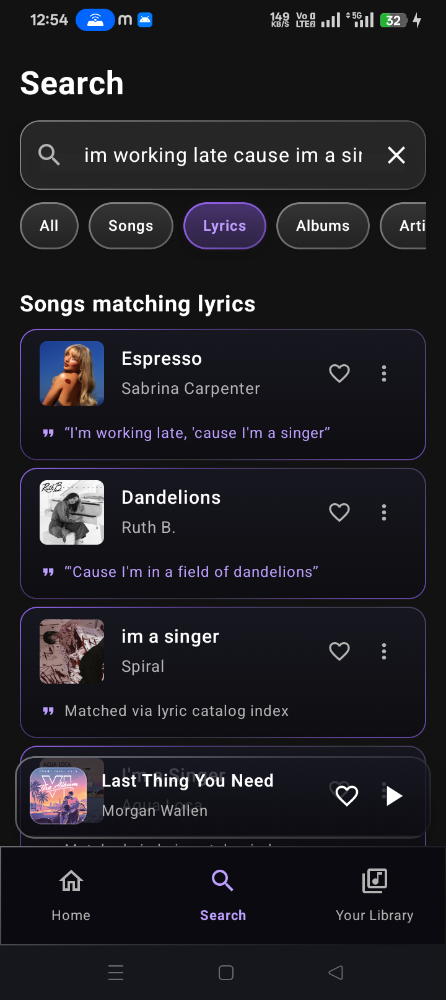
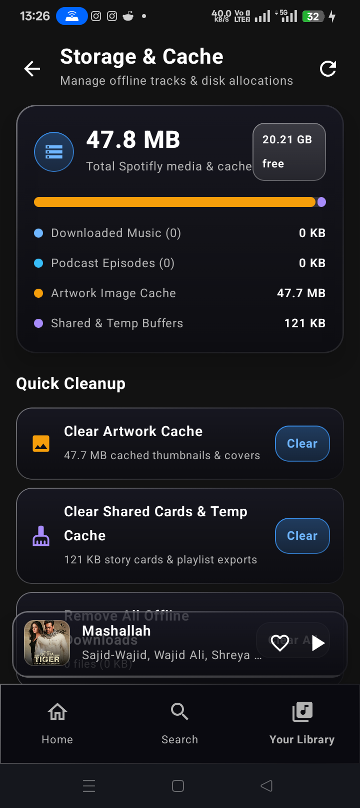

# 🎵 Spotifly — Dark Cinematic Android Music Player

<p align="center">
  <a href="https://github.com/ALternate-cloud/Spotifly/releases/download/v2.1/Spotifly-2.1.apk"><strong>Download Spotifly 2.1 APK</strong></a>
  &nbsp;•&nbsp;
  <a href="https://github.com/ALternate-cloud/Spotifly/releases/tag/v2.1"><strong>Release Notes & SHA-256</strong></a>
  &nbsp;•&nbsp;
  <a href="LICENSE"><strong>Non-Commercial License</strong></a>
</p>

> **Requires Android 7.0 (API 24) or newer.** Download `Spotifly-2.1.apk`, tap it to open, and choose **Install** (allow installation from your browser or file manager if prompted). This is a debug-signed release compatible with `v1.1` / `v1.2` / `v2.0` in-place upgrades so existing users keep their local library.

**Spotifly** is a native Android music player built with **Jetpack Compose**, **AndroidX Media3 (ExoPlayer)**, and **Material 3**. Version **2.1** adds an **Endless Unlimited Autoplay Queue** with chained tail seeding and infinite queue loading plus an **In-App GitHub Update Checker** (in Settings, About, and as an automatic startup dialog), building on the **2.0** Dark Cinematic visual system with frosted glassmorphism, dual **Curved** and **Immersive** player modes, real-time audio visualizers, tap-to-slide synchronized lyrics, live global/regional charts, lyric search, shareable story cards, granular storage tools, and playlist backup/import.

---

## 📸 Screenshots

<table>
  <tr>
    <td align="center"><strong>Home & Live Charts</strong><br/></td>
    <td align="center"><strong>Curved Player</strong><br/></td>
    <td align="center"><strong>Immersive Visualizer</strong><br/></td>
  </tr>
  <tr>
    <td align="center"><strong>Slide-to-Lyrics</strong><br/></td>
    <td align="center"><strong>Search by Lyrics</strong><br/></td>
    <td align="center"><strong>Storage Dashboard</strong><br/></td>
  </tr>
</table>

---

## ✨ Key Features

### 🎨 Dark Cinematic UI & Players
* **Obsidian Dark Palette & Frosted Glassmorphism**: High-contrast dark surfaces, dynamic album-art ambient glow, floating glassmorphic navigation & mini-player, and an **Arc Mosaic Discovery** showcase (`DiscoverOnboardingScreen`).
* **Curved & Immersive Player Modes**:
  * **Curved Mode**: Squircle artwork, radial progress arc, glowing neon control pod, and quick-switch lyrics badge.
  * **Immersive Mode**: Circular disc with orbital progress ring and an audio-reactive visualizer supporting **2D Spectrum**, **2D Waveform**, and **3D Radial** modes.
* **Dynamic Slide-to-Lyrics**: Tap the album cover (or lyrics pill) in either player mode to smoothly slide between artwork and live **LRCLIB** synchronized karaoke lyrics; tap any lyric line to seek directly to that timestamp.
* **Shareable Story Cards**: Generate styled `9:16` Story or `1:1` Square song cards featuring artwork, waveform graphics, and synced lyric quotes for saving to gallery or sharing natively.

### 🔎 Discovery, Streaming & Hybrid Playback
* **Global & Regional Charts**: Curated live shelves (*Global Top 25*, *India Top 25 / Superhits*, *UK Top 25*, *India Hot 25*) with inline play and full ranked `ChartDetailSheet`.
* **Search by Lyrics & Related Artists**: Locate songs by remembered lyric snippets with LRCLIB line verification, and explore *"Fans Also Like"* graphs on artist detail screens.
* **Online Catalogs + Local Device Music**: Multi-provider online streaming (JioSaavn, iTunes, Deezer) unified with local device `.mp3`, `.m4a`, `.flac`, and `.wav` playback via Android `MediaStore` (`READ_MEDIA_AUDIO` on Android 13+).
* **Drag-and-Drop Queue & Endless Unlimited Autoplay Queue**: Reorder upcoming songs by dragging queue handles, start **Song Radio** powered by PCM Vibe Vector similarity, enjoy **Endless Unlimited Autoplay** with chained tail seeding and infinite scroll/on-demand queue loading, and save active queues as playlists.

### 🧰 Offline, Audio Effects & Power-User Tools
* **In-App GitHub Update Checker**: Automatically checks GitHub Releases on startup (with 12-hour throttling and version-skip support) and provides manual update checks with direct APK download and release notes from **Settings**, **About**, and a startup **Update Available** dialog.
* **Audio Engine & Smart Sleep Timer**: 5-band Equalizer, Bass Boost, Crossfade, Mono Audio toggle, Loudness normalization, and a **Sleep Timer** with a progressive 30-second volume fade-out.
* **Granular Storage & Cache Dashboard**: Inspect disk usage across downloaded tracks, podcast episodes, artwork cache, and temp buffers with one-tap category cleanup.
* **Playlist Export & Import**: Export individual playlists to `.m3u8` / `.json`, create full-library JSON backups via Android SAF or share sheets, and import from files or pasted track lists.
* **Native Media3 Background Service**: Lock-screen and notification playback controls via `MediaSessionService`, audio focus management, and clean service/notification teardown when paused tasks are swiped from Recents.

---

## 📱 Installing the APK on Your Phone

### Method 1: Direct APK Download (Recommended)
1. Download [`Spotifly-2.1.apk`](https://github.com/ALternate-cloud/Spotifly/releases/download/v2.1/Spotifly-2.1.apk) on your Android device.
2. Open the downloaded file and tap **Install** (enable *"Allow from this source"* if prompted).
3. Launch **Spotifly** and enjoy!

### Method 2: Via USB Cable / ADB
If you build from source with Developer Options & USB Debugging enabled:
```bash
./gradlew assembleDebug
adb install -r app/build/outputs/apk/debug/app-debug.apk
```

---

## 🛠️ Project Structure & Architecture

```
com.example.spotifly
├── MainActivity.kt                      // Edge-to-edge Compose entrypoint & deep link handling
├── Navigation.kt / NavigationKeys.kt    // Navigation 3 router & typed route keys
├── model/                               // Song, Lyrics, Podcast & AppSettings models
├── data/
│   ├── DataRepository.kt                // Central repository orchestration
│   ├── online/
│   │   ├── OnlineMusicService.kt        // Search, streaming URLs & LRCLIB synced lyrics
│   │   ├── DiscoveryService.kt          // Global/regional charts, related artists & lyric search
│   │   └── PlaybackResolver.kt          // Multi-provider stream resolution & candidate scoring
│   ├── local/LocalMusicRepository.kt    // MediaStore local audio scanner
│   ├── offline/
│   │   ├── OfflineMusicManager.kt       // Offline track downloads & caching
│   │   └── StorageInspector.kt          // Disk allocation & cache breakdown inspector
│   ├── playlist/
│   │   ├── PlaylistRepository.kt        // Local playlists & liked songs storage
│   │   └── PlaylistBackupManager.kt     // .m3u8 / .json export, import & full backup
│   ├── autoplay/                        // PCM Vibe Vector analysis & similarity radio ranking
│   ├── update/AppUpdateChecker.kt       // GitHub Releases update checker, semver & skip persistence
│   ├── cloud/                           // Firebase Auth & Firestore library sync
│   ├── podcast/                         // RSS podcast feeds & parser
│   ├── prefs/                           // UserPreferencesManager
│   └── stats/                           // Listening statistics tracking
├── player/
│   ├── MusicController.kt               // MediaController binding, queue & playback state flow
│   ├── AudioEffectsManager.kt           // 5-band EQ, Bass Boost & Loudness
│   ├── PlaybackTuning.kt                // Crossfade & sleep timer fade curves
│   └── MonoAudio.kt                     // Mono downmix renderer factory
├── service/
│   └── MusicPlaybackService.kt          // Media3 foreground MediaSessionService
├── theme/                               // Color, Type, Theme & Glassmorphism tokens
├── widget/                              // Home-screen Now Playing widget
└── ui/
    ├── main/                            // MainScreen scaffold & MainScreenViewModel
    ├── home/HomeScreen.kt               // Hero trending banner, charts & personalized feed
    ├── search/SearchScreen.kt           // Songs, Lyrics, Albums & Artists search
    ├── library/                         // LibraryScreen & PlaylistDetailView
    ├── onboarding/                      // DiscoverOnboardingScreen (Arc Mosaic showcase)
    ├── album/ & artist/                 // AlbumDetailScreen & ArtistDetailScreen
    ├── settings/                        // AudioSettingsScreen, StorageDashboardScreen & AboutScreen
    ├── stats/StatsScreen.kt             // Listening stats screen
    ├── podcast/PodcastsScreen.kt        // Podcasts browser
    └── components/
        ├── MiniPlayer.kt                // Glassmorphic persistent mini-player
        ├── FullPlayerModal.kt           // Full player modal (Curved & Immersive switcher)
        ├── CurvedPlayerWidgets.kt       // Radial arc seekbar & neon control pod
        ├── ImmersivePlayerWidgets.kt    // Circular disc & 2D/3D audio visualizer
        ├── LyricsView.kt                // ArtworkLyricsSlideStage & synced lyrics view
        ├── QueueBottomSheet.kt          // Drag-and-drop queue sheet
        ├── ChartDetailSheet.kt          // Full ranked chart sheet
        ├── ShareCardModal.kt / ShareUtils.kt // 9:16 & 1:1 Story card generator & sharing
        ├── UpdateAvailableDialog.kt     // In-app GitHub update available modal dialog
        └── SettingsSheet.kt             // App settings, update check & cloud backup controls
```

---

## 💻 Rebuilding from Source

Install **Android SDK Platform 36** and accept its licenses through Android Studio or the Android command-line tools. Use **JDK 17 or newer** to run Gradle (`compileOptions` and Kotlin toolchain target JVM 17).

Configure the SDK via Android Studio, `ANDROID_HOME`, or an untracked `local.properties` file containing `sdk.dir=/absolute/path/to/Android/Sdk`.

```bash
./gradlew assembleDebug
```

The output APK is `app/build/outputs/apk/debug/app-debug.apk`. Android 7.0 (API 24) or newer is supported. Version **2.1** uses Android `versionCode 7`.

---

## 📻 Radio & Saved Mixes

Choose **Start Radio** from any song's menu to queue similar tracks. Autoplay uses measured PCM audio features (`AudioVibeAnalyzer` / `PcmVibeAnalyzer`) where available, with metadata ranking as a fallback. Open the queue and tap **Save** to store the current mix as a playlist in **Your Library**.

---

## ✅ Verification

```bash
./gradlew lintDebug
./gradlew testDebugUnitTest --tests 'com.example.spotifly.data.*' --tests 'com.example.spotifly.player.*' --tests 'com.example.spotifly.model.*' --tests 'com.example.spotifly.ui.*'
```

To run the full unit test suite (including `Track3FeaturesTest` and `MusicPlaybackServiceTest`):
```bash
./gradlew testDebugUnitTest
```

`AcceptanceTests` calls live services and generates a report. The live test in `SearchCoverageTest` is opt-in:
```bash
SPOTIFLY_LIVE_TESTS=1 ./gradlew testDebugUnitTest --tests 'com.example.spotifly.data.online.SearchCoverageTest'
```

Instrumented tests require a connected Android device or emulator:
```bash
./gradlew connectedDebugAndroidTest
```

> Keep SDK paths, credentials, signing keys, and build outputs out of source control. Release builds should use your own private keystore retained across updates.

---

## ☁️ Optional Cloud Library Backup

Google sign-in in **Settings** enables automatic backup of playlists and liked songs using Firebase Authentication and Cloud Firestore. Reinstalling and signing into the same account restores backed-up library data (ensure pending changes finish syncing before uninstalling; local device audio files and local cover images stay on their original device).

For your own Firebase deployment:
1. Register an Android app as `com.example.spotifly`.
2. Enable Google authentication and add your APK signing certificate's SHA-1 fingerprint.
3. Place your client config at `app/google-services.json` and deploy [`firestore.rules`](firestore.rules) (which restricts each user's data to their authenticated UID).

Test Firestore security rules locally against the Firebase emulator:
```bash
npm install --prefix .firebase-test-tools firebase-tools @firebase/rules-unit-testing firebase
NODE_PATH="$PWD/.firebase-test-tools/node_modules" .firebase-test-tools/node_modules/.bin/firebase emulators:exec --only firestore --project demo-spotifly-rules 'node --test scripts/test-firestore-rules.cjs'
```

---

## 📄 License

Copyright © 2026 **ARYAN ALTERNATE (ALternate-cloud)**.

Spotifly is licensed under a **[Non-Commercial License](LICENSE)** — you are free to view, use, and modify the code for personal and non-commercial purposes, while any commercial use, sale, or monetization requires prior written permission.
